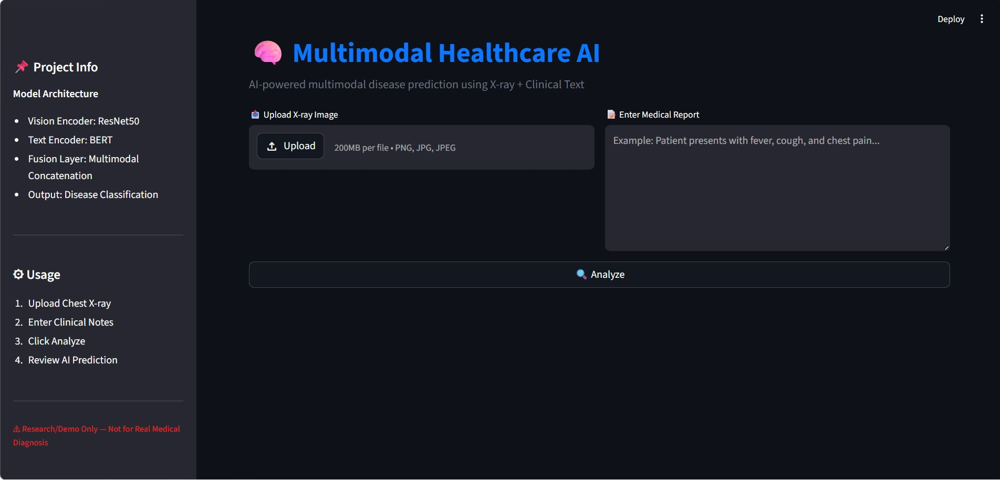
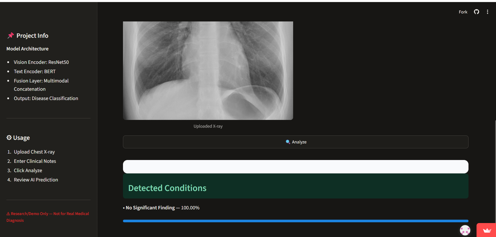

# Multimodal Healthcare AI

An AI-powered research project that combines **medical image analysis** and **clinical text understanding** to explore multimodal disease classification.

## 🚀 Live Demo

- **Streamlit App:** https://multimodal-healthcare-ai-hcngqzw2hj9chk4qqddnwz.streamlit.app/
- **GitHub Repository:** https://github.com/anuptripathi5592/Multimodal-Healthcare-AI
- **Hugging Face Model:** https://huggingface.co/anuptripathi5592/multimodal-healthcare-ai

## 📌 Project Overview

Multimodal Healthcare AI combines information from two different data modalities:

1. Medical images
2. Clinical text notes

The project uses deep learning models to extract image and text features, combines them into a shared representation, and generates disease classification scores.

**Important:** This project is an educational and research demonstration. It is not intended for real-world diagnosis or clinical decision-making.

## ✨ Key Features

- Medical image feature extraction using ResNet50.
- Clinical text feature extraction using BERT.
- Multimodal feature fusion.
- Multi-label disease classification.
- Top-3 prediction display.
- Disease information cards.
- Interactive Streamlit interface.
- Model checkpoint hosted on Hugging Face.

## 🧠 Model Architecture

The project follows this architecture:

```text
          Medical Image
                |
             ResNet50
                |
          Image Features
                |
                | 
                +------ Feature Fusion
                |
                |
          Clinical Text
                |
               BERT
                |
          Text Features
                |
                |
          Classification
                |
          Disease Scores
                |
           Top-3 Results
```

## 🛠️ Technology Stack

| Category | Technologies |
|---|---|
| Programming | Python |
| Deep Learning | PyTorch |
| Computer Vision | ResNet50 |
| NLP | BERT, Transformers |
| Frontend | Streamlit |
| Model Hosting | Hugging Face |
| Deployment | Streamlit Community Cloud |
| Version Control | Git & GitHub |

## 📂 Project Structure

```text
Multimodal-Healthcare-AI/
│
├── src/
│   └── predict.py
│
├── ui/
│   └── app.py
│
├── screenshots/
│   └── home.png
│
├── artifacts/
│   └── model checkpoint (hosted separately)
│
├── .gitignore
├── README.md
└── requirements.txt
```

## ⚙️ Run Locally

### 1. Clone the repository

```bash
git clone https://github.com/anuptripathi5592/Multimodal-Healthcare-AI.git
```

### 2. Open the project directory

```bash
cd Multimodal-Healthcare-AI
```

### 3. Create a virtual environment

```bash
python -m venv .venv
```

### 4. Activate the environment (Windows PowerShell)

```powershell
.\.venv\Scripts\Activate.ps1
```

### 5. Install dependencies

```bash
pip install -r requirements.txt
```

### 6. Run the Streamlit application

```bash
streamlit run ui/app.py
```

## 🤗 Model Hosting

The trained model checkpoint is hosted separately on Hugging Face to avoid storing large model files directly in the GitHub repository.

**Model:** https://huggingface.co/anuptripathi5592/multimodal-healthcare-ai

## 📸 Screenshots

### Application Interface



### Prediction Results



## 🔮 Future Improvements

- Improve model evaluation and validation.
- Add more comprehensive performance metrics.
- Enhance prediction explainability.
- Improve user interface and accessibility.
- Explore additional medical image and text datasets.
- Add automated testing and API integration.

## ⚠️ Disclaimer

This project is developed for educational and research purposes only.

Predictions are experimental model outputs and must not be considered medical advice, a confirmed diagnosis, or a substitute for evaluation by qualified healthcare professionals.

## 👨‍💻 Author

**Anup Tripathi**

B.Tech CSE (Data Science)

GitHub: https://github.com/anuptripathi5592

LinkedIn: https://linkedin.com/in/anup-tripathi-a10a0533

---

⭐ If you find this project interesting, consider giving the repository a star!